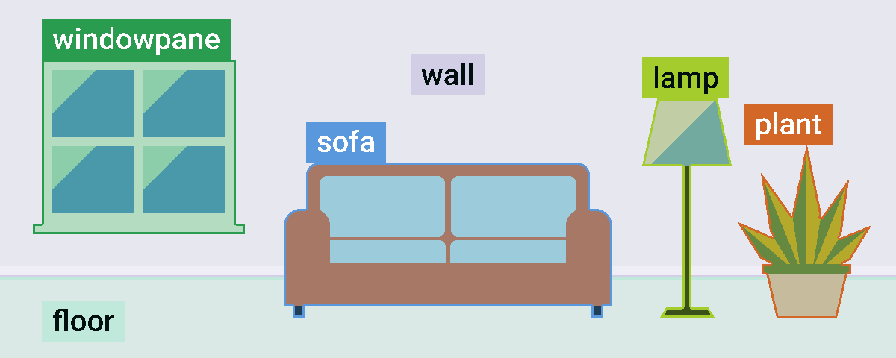

# SegFormer-B0

## Overview

SegFormer-B0 is the smallest size of NVIDIA's SegFormer semantic segmentation
transformer, fine-tuned on ADE20K. It labels every pixel of a scene with one of
150 classes, such as wall, sky, floor, tree, person and car. It takes a 512×512
RGB image and returns class scores on a 128×128 grid, a quarter of the input
resolution. A hierarchical transformer encoder reads the image at four scales,
and a light all-MLP head fuses them. The model runs as one component.

## Inputs and outputs

**Input.** Stretch the image to 512×512 with bilinear resampling, with no crop
or padding. Scale the RGB values to 0–1, subtract the ImageNet mean (0.485,
0.456, 0.406), and divide by the standard deviation (0.229, 0.224, 0.225). Neat
can do this with its stretch resize and the ImageNet normalization preset.

**Outputs.** `logits` holds 150 class scores for each cell of a 128×128 grid.

1. Resize `logits` bilinearly to the image's height and width.
2. At each pixel, take the class with the highest score.

Class index i is class i of the standard 150-class ADE20K scene-parsing order,
from 0 wall, 1 building, 2 sky and 3 floor to 149 flag, which is the `id2label`
order of the upstream `config.json`. Neat's semantic-segmentation decode can also
run both steps: set `semantic_segmentation.enable` and the output size in the
model options, and the model returns one class index per pixel.

## Building applications

Run the package with the [Neat Model
API](https://developer.sima.ai/software/develop-apps/development-workflow/model).
For complete applications, start from the [Neat example
apps](https://developer.sima.ai/examples).
