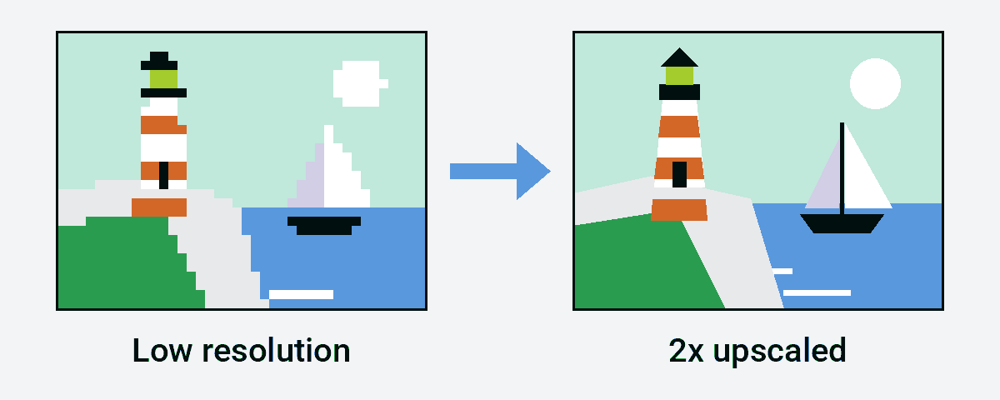

# SESR-M7 2x

## Overview

SESR-M7 2x doubles the width and height of an image. It takes one 224×224 RGB tile and returns the matching 448×448 tile, adding back detail that plain resizing blurs away. SESR is a super-efficient super-resolution network built from collapsible linear blocks; this size has seven residual blocks of 16 channels. It runs as one compiled model. To upscale a larger picture, cut it into overlapping tiles, upscale each, and stitch the tile centres back together.

## Inputs

One input, `lr_tile`: a 224×224×3 (height, width, channel) RGB tile with values from 0 to 1.

Preprocessing:

1. Take a 224×224 crop of the image at its original resolution, without resizing it.
2. Divide the pixel values by 255, with no mean or standard deviation.

## Outputs

One output, `sr_tile`: the upscaled 448×448×3 RGB tile, with values nominally from 0 to 1.

Postprocessing:

1. Clip each value to the range 0 to 1.
2. Multiply by 255 and round to 8-bit pixels.
3. To upscale an image larger than one tile, overlap neighbouring tiles by 32 input pixels, keep the central 192×192 input pixels of each tile (384×384 output pixels), and reflect the image outward by 16 pixels at its edges.

There are no classes.

## Building applications

Run the package with the [Neat Model API](https://developer.sima.ai/software/develop-apps/development-workflow/model). For complete applications, start from the [Neat example apps](https://developer.sima.ai/examples).
