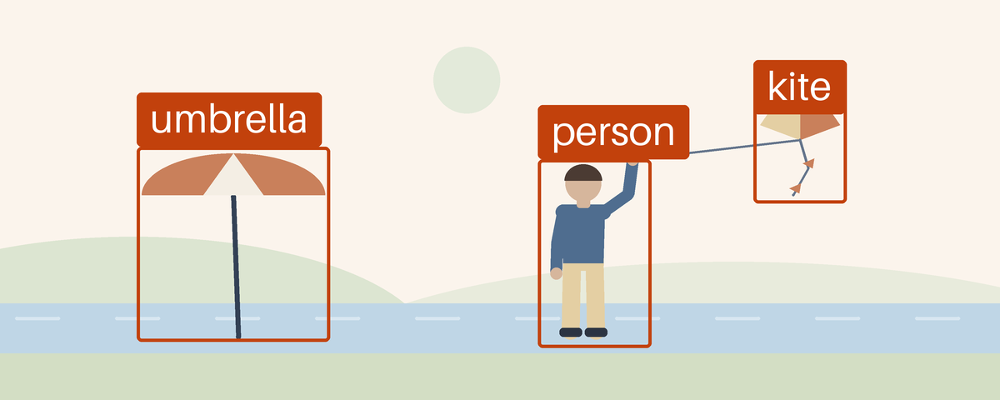

# SSD-MobileNet V2

## Overview

SSD-MobileNet V2 is a lightweight single-shot object detector trained on COCO.
It combines a MobileNet V2 backbone with predictions from 1,917 reference
boxes, also called anchors, over six grid levels. The network returns separate
box offsets and class logits. Your application can decode these predictions
with the source reference steps below, or select Neat's SSD decoder for a
single bounding-box result in the original image's coordinates.

## Inputs and outputs

**Input.** The network expects 300×300 RGB values scaled to -1 to 1. With the
Model API image route, pass the original RGB image and enable stretch resizing
with explicit mean and standard deviation of 0.5. Do not resize or normalize
again in the application. The source reference uses TensorFlow's asymmetric
bilinear resize; the native image route is not claimed to be bit-equivalent.

**Compiled outputs.** Twelve tensors over grids of 19, 10, 5, 3, 2 and 1 cells.
The first grid has three anchors per cell; the others have six:

- `ssd_loc_0` to `ssd_loc_5`: box offsets (y, x, height, width), four values per anchor.
- `ssd_confidence_0` to `ssd_confidence_5`: 91 class logits per anchor.

The independent source reference decodes them as follows:

1. Reconstruct the source export's exact FP32 reference boxes for the six grids.
2. Multiply offsets by FP32 0.1, 0.1, 0.2 and 0.2, adjust each reference box, clip to the image and discard nonpositive-area boxes.
3. Apply a sigmoid to the foreground logits.
4. Suppress overlapping boxes within each class and keep the best 100 detections overall.
5. Map the boxes to the original image dimensions.

Class index i is COCO category ID i; index 0 is background and ten indexes are
unused. `BoxDecodeType.Ssd` selects Neat's native multiclass SSD
policy and returns one typed bounding-box tensor. Its results are not claimed to be bit-equivalent to
the floating-point source reference. The pinned V1 and V2 exports share this
TF300 decoding contract; no backbone-specific decoder option is needed.

## Building applications

Run the package with the [Neat Model API](https://developer.sima.ai/software/develop-apps/development-workflow/model).
For complete applications, start from the [Neat example apps](https://developer.sima.ai/examples).
