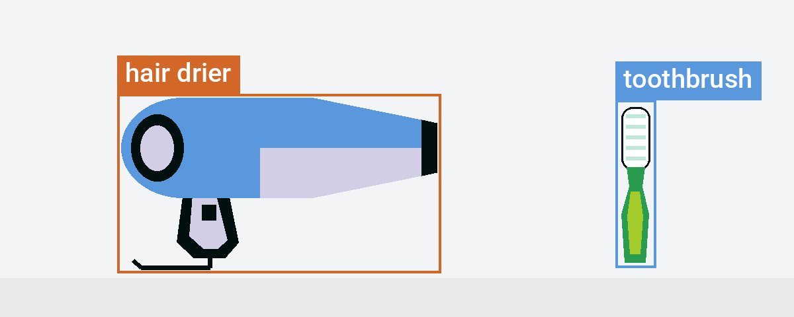

# SSD-MobileNet V3

## Overview

SSD-MobileNet V3 is a single-shot object detector using TorchVision's
SSDLite320 network and MobileNet V3 Large backbone, trained on COCO. It predicts
objects from 3,234 reference boxes across six grid levels. The network returns
separate box offsets and class logits. Your application can decode those
predictions with the source reference steps below, or select Neat's SSD decoder
for one bounding-box result in the original image's coordinates.

## Inputs and outputs

**Input.** The network expects 320×320 RGB values scaled to -1 to 1. With the
Model API image route, pass the original RGB image and enable stretch resizing
with explicit mean and standard deviation of 0.5. Do not resize or normalize
again in the application. The source reference normalizes before half-pixel
bilinear resizing without antialiasing; the native route is not claimed to be
bit-equivalent.

Conversion preserves the detector; compilation cuts raw heads. The Model API supplies
preprocessing and decoding.

**Compiled outputs.** Twelve tensors over grids of 20, 10, 5, 3, 2 and 1 cells,
with six reference boxes per cell:

- `ssd_loc_0` to `ssd_loc_5`: box offsets (x, y, width, height), four values per reference box.
- `ssd_confidence_0` to `ssd_confidence_5`: 91 class logits per reference box.

The independent source reference decodes them as follows:

1. Generate TorchVision's reference boxes for the six grids.
2. Apply the box offsets with scales 10, 10, 5 and 5, limit the size exponent to log(1000/16), and clip the boxes to the image.
3. Apply softmax over all 91 classes, including background.
4. Keep up to 300 candidates per foreground class, suppress overlaps within that class, and retain the best 300 overall.
5. Map box corners to the original image dimensions before converting them to positions and sizes.

Class index i is COCO category ID i; index 0 is background.
`BoxDecodeType.Ssd` selects Neat's native multiclass SSD policy and
returns one typed bounding-box tensor. Its results are not claimed to be bit-equivalent to the
floating-point source reference. Other prepared SSD contracts retain their numerical policy.

## Building applications

Run the package with the [Neat Model API](https://developer.sima.ai/software/develop-apps/development-workflow/model).
For complete applications, start from the [Neat example apps](https://developer.sima.ai/examples).
