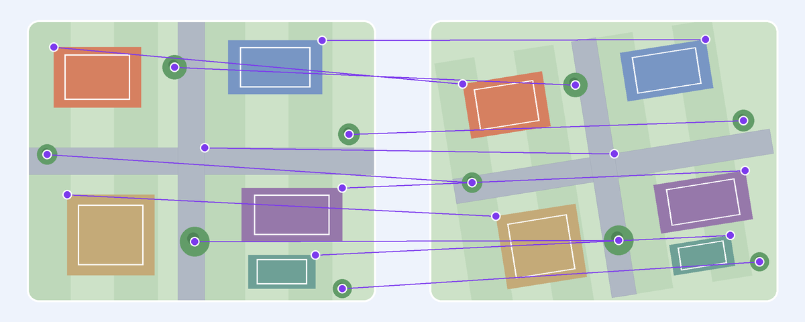

# SuperGlue Outdoor

## Overview

SuperGlue Outdoor matches keypoints between two images of the same outdoor scene,
such as consecutive drone frames, for visual odometry, mapping, and image
alignment. It takes the keypoints, keypoint scores, and descriptors that
SuperPoint detects in each image, 512 per image, and returns a score for every
keypoint pair plus an unmatched option for each keypoint. Your application turns
the scores into matches with the steps below. The model does not detect
keypoints; run SuperPoint first.

## Inputs and outputs

**Inputs.** Run SuperPoint with a keypoint score threshold of 0.0005, so each
image yields at least 512 keypoints, and keep the 512 with the highest scores.
Pass three float tensors per image (0 and 1):

- `keypoints0`, `keypoints1`: 512 × 2 (x, y) pixel positions, minus half the image width and height, divided by 0.7 times the longer image side.
- `scores0`, `scores1`: 512 × 1 keypoint scores.
- `descriptors0`, `descriptors1`: 512 × 256 SuperPoint descriptors.

**Output.** `couplings` is a 513 × 513 score matrix: entry (j, i) scores
image-0 keypoint i against image-1 keypoint j, and index 512 is each image's
unmatched option. Transpose it so rows are image-0 keypoints.

1. Subtract the matrix maximum and take the exponent of every entry.
2. Run 100 Sinkhorn iterations: alternately rescale rows and columns so rows 0–511 each sum to 1/1024 and row 512 to 512/1024, and the same for columns.
3. Multiply the result by 1024.
4. For each image-0 keypoint, find its best image-1 keypoint, ignoring index 512.
5. Keep the pair only if that image-1 keypoint's best is the same image-0 keypoint.
6. The pair's value is its match score; drop matches below your threshold, such as 0.2.

No Neat decoder handles these outputs; run the steps on the CPU.

## Building applications

Run the package with the [Neat Model API](https://developer.sima.ai/software/develop-apps/development-workflow/model). For complete applications, start from the [Neat example apps](https://developer.sima.ai/examples).
