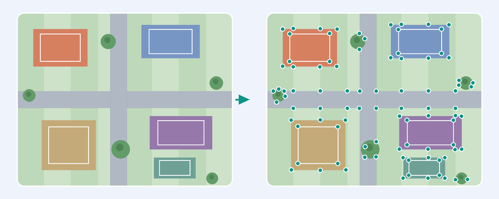

# SuperPoint

## Overview

SuperPoint finds distinctive points in an image, such as corners and texture
details, and returns each as a keypoint with a position, a score, and a
256-number descriptor. Match the descriptors of two images, such as consecutive
drone frames, to link the same scene points for visual odometry, mapping, and
image alignment. SuperPoint does not match them itself: compare the descriptors
in your application, or use a matcher such as SuperGlue or LightGlue.

## Inputs

One 640×480 (width × height) grayscale image, `image`, with values from 0 to 1.

- With Neat: pass your frame as an RGB image, with stretch resizing, RGB-to-grayscale conversion, and normalization on.
- Yourself: resize to 640×480 with area interpolation, mix red, green, and blue as 0.2989, 0.5870, and 0.1140, scale to 0–1, and pass a 480×640×1 (height, width, channel) float tensor with Neat's preprocessing off.

Neat's grayscale conversion keeps only the red channel. For the trained color mix, use the manual path.

## Outputs

Keypoints, each with a position, a score, and a unit-length descriptor.

- With Neat: the SuperPoint decoder returns the keypoints. Its `LightGlueV1` profile runs the steps below, but its default score threshold is 0.0005, the value the SuperGlue and LightGlue packages expect. Set the threshold to 0.005 to match step 3. Its `MagicLeapDemoV1` profile runs Magic Leap's demo decode instead, which keeps pixels scoring at least 0.015 before suppression. `top_k` limits the count.
- Yourself: decode these tensors, both on an 80×60 grid, one cell per 8×8 pixels.

| Tensor | Per cell |
|---|---|
| `logits` | 65 values: one per pixel of the cell plus a "no keypoint" value |
| `descriptors` | 256 values, not yet scaled to unit length |

1. Apply softmax over each cell's 65 values, drop the last, and place the other 64 on the cell's pixels, row by row.
2. Keep a pixel only if it has the highest score within 4 pixels after suppression.
3. Keep pixels scoring above 0.005, at least 4 pixels from every edge, and the best ones if you need fewer.
4. Scale each cell's descriptor to unit length, interpolate it at each keypoint, and scale again.

## Building applications

Run the package with the [Neat Model API](https://developer.sima.ai/software/develop-apps/development-workflow/model). For complete applications, start from the [Neat example apps](https://developer.sima.ai/examples).
