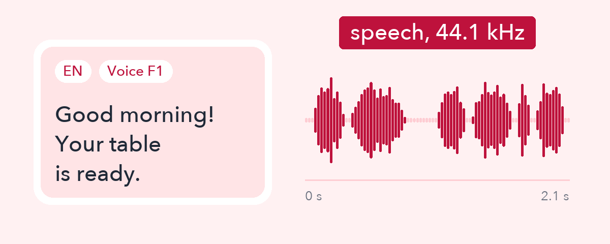

# Supertonic 3

## Overview

Supertonic 3, from Supertone, speaks text, for voice interfaces, spoken alerts,
and narration. It turns a sentence of up to about 180 characters, in one of 31
languages and ten voices, into up to 13.4 seconds of 44.1 kHz audio. Your
application runs two text models on the CPU. A vector estimator turns
noise into speech features over eight steps, with a CPU update after each, and
a vocoder turns them into sound.

## Inputs

A sentence, its language, and a voice. The package holds both components, `supertonic_runtime_data.npz`, and Supertone's text models and voices under `supertonic-3/`.

Preprocessing:

1. Normalize the text: NFKD, no emoji, plain quotes and dashes, single spaces, and a final period unless punctuation ends it.
2. Wrap it in its language tag, such as `<en>Hello.</en>`.
3. Map each character to a number with `supertonic-3/onnx/unicode_indexer.json`, up to 192. It has no precomposed letters such as `é`.
4. Load a voice's `style_ttl` and `style_dp`, such as `F1`, from `supertonic-3/voice_styles/`.
5. Run `supertonic-3/onnx/duration_predictor.onnx` on the numbers as `text_ids`, `style_dp`, and an all-ones `text_mask`. Divide its result, the length in seconds, by the speed.
6. Run `supertonic-3/onnx/text_encoder.onnx` on `text_ids`, `style_ttl`, and `text_mask` for the text embedding.

## Between the components

1. Make ceil(length × 44,100 / 3,072) frames, at most 192, of 144 random normal values each.
2. Pad frames and text embedding to 192. Set `latent_mask` and `text_mask` to 1 on real frames and characters, else 0.
3. Take rows (frames − 1) and (characters − 1) of `rope_sin_cos_by_length` in `supertonic_runtime_data.npz` as `rope_tables`.
4. Repeat steps 5 to 7 for k = 0 to 7.
5. Set `time_sinusoidal` to the sines, then cosines, of (k / 8) × 1000 × 10000^(−i/31), i = 0 to 31.
6. Run the vector estimator on a batch of two. Slot 0 takes the text embedding as `text_emb`, `style_ttl`, and `conditional_style_key` as `style_key`. Slot 1 takes `unconditional_text`, `unconditional_style_value`, and `unconditional_style_key` instead. These four keys are runtime data. The other inputs are shared.
7. Add (4 × slot 0's `velocity` − 3 × slot 1's) / 8 to the frames, and multiply by `latent_mask`.
8. Pass the frames to the vocoder as `latent`.

## Outputs

`wav_frames` holds 44.1 kHz audio samples.

Postprocessing:

1. Read `wav_frames` in order as one waveform.
2. Keep the first length × 44,100 samples.

## Building applications

Run the package with the [Neat Model API](https://developer.sima.ai/software/develop-apps/development-workflow/model). For complete applications, start from the [Neat example apps](https://developer.sima.ai/examples).
