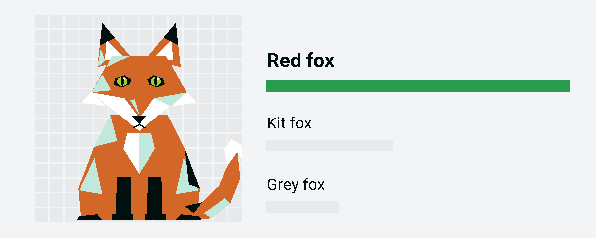

# ViT-B/16

## Overview

ViT-B/16 sorts an image into one of the 1,000 ImageNet classes, such as animals,
vehicles, and household objects. Use it to tag or sort photos, or to check what
a camera is looking at. It returns one score for each class, and your
application reports the most likely ones. It names the main subject of the image
and does not locate it. It is the base size of Google's Vision Transformer,
which reads the image as 16×16 patches. Google pretrained it on ImageNet-21k and
fine-tuned it on the 1,000 classes of ImageNet-1k.

## Inputs

One 224×224×3 (height, width, channel) RGB image, with values from −1 to 1.

Preprocessing:

1. Resize to 224×224 with bilinear resampling, without keeping the aspect ratio.
2. Divide by 255.
3. Subtract (0.5, 0.5, 0.5) from the red, green, and blue channels.
4. Divide them by (0.5, 0.5, 0.5).

## Outputs

One output, `logits`, with one score for each of the 1,000 classes.

Postprocessing:

1. Apply a softmax to `logits` to get class probabilities.
2. Take the highest probability as the class, or the five highest as the top-5 classes.

Class index i is the i-th ImageNet-1k WordNet ID in sorted order, which is the standard ImageNet-1k class order.

## Building applications

Run the package with the [Neat Model
API](https://developer.sima.ai/software/develop-apps/development-workflow/model).
For complete applications, start from the [Neat example
apps](https://developer.sima.ai/examples).
