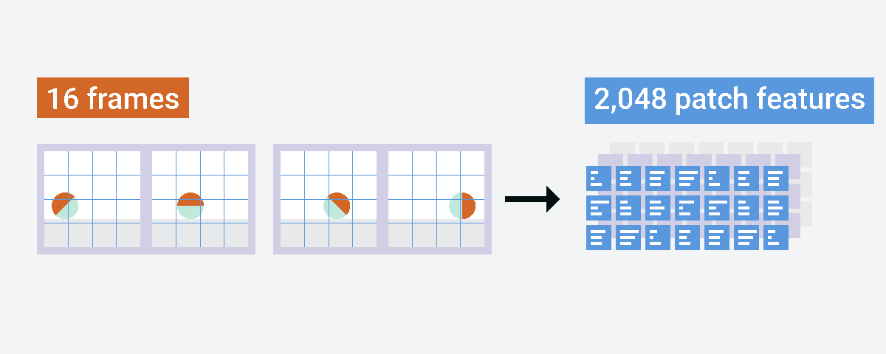

# V-JEPA 2.1 ViT-B 16x256

## Overview

V-JEPA 2.1 ViT-B is Meta's self-supervised video encoder. It reads a clip of 16
RGB frames at 256×256 and returns a 768-value feature vector for every
spatio-temporal patch: 2 frames by 16×16 pixels, 2,048 patches in all. The
features describe what is in the clip and how it moves, for a small task head of
your own, such as action classification, retrieval or anticipation. The encoder
runs as three components, one after another: `encoder_0`, `encoder_1` and
`encoder_2`, each holding four of its twelve transformer blocks.

The registry has no video dataset, so the compile stage compares each build with
the float32 model on 16-frame pans across COCO 2017 validation images.

## Inputs

One input to `encoder_0`, `video`: a clip of 16 consecutive RGB frames, normalized with the ImageNet mean and standard deviation and packed as 2048×256×6 (height, width, channel).

Preprocessing:

1. Resize each RGB frame with bilinear resampling so its shorter side is 256, and crop the centre 256×256.
2. Divide by 255, then subtract (0.485, 0.456, 0.406) and divide by (0.229, 0.224, 0.225), per channel.
3. Group the frames in pairs, as 8 tubelets.
4. Stack the tubelets down the height: tubelet t fills rows 256·t to 256·t + 255, and its channels are the first frame's red, green and blue, then the second frame's.

## Between the components

`encoder_0` and `encoder_1` each return `tokens`, 768 channels by 2,048 patches.

1. Pass `encoder_0`'s `tokens` unchanged to `encoder_1` as `input_tokens`.
2. Pass `encoder_1`'s `tokens` unchanged to `encoder_2` as `input_tokens`.

## Outputs

One output from `encoder_2`, `features`: 768 channels by 2,048 patches.

Postprocessing:

1. Patch p is tubelet p ÷ 256, row (p ÷ 16) mod 16 and column p mod 16 of the 16×16 patch grid.
2. Average the patches for one vector per clip, or keep the grid for a head that attends over space and time.

There are no classes: the features feed a task head of your own.

## Building applications

Run the package with the [Neat Model
API](https://developer.sima.ai/software/develop-apps/development-workflow/model).
For complete applications, start from the [Neat example
apps](https://developer.sima.ai/examples).
