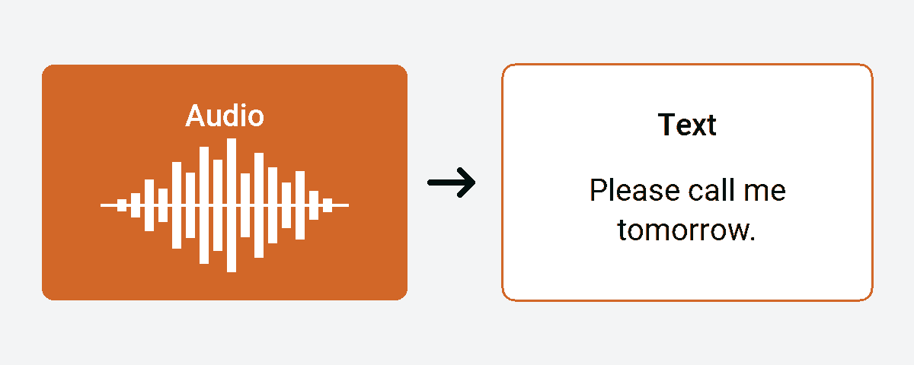

# Whisper Large v3 Turbo

## Overview

Whisper Large v3 Turbo turns speech into text. Use it for voice interfaces,
dictation, and transcripts of short recordings in many languages. Your
application supplies an audio recording and gets its transcription back as text.
You can select the spoken language or let the model detect it. It handles at
most 30 seconds of audio at a time, and it returns no speaker labels or word
timestamps. It is the Large v3 Turbo size of the Whisper family from OpenAI.

## Inputs and outputs

### Inputs

One audio recording of at most 30 seconds.

- `audio`: mono samples at 16,000 samples per second, as floating-point values from -1 to 1.
- Longer recordings: split them into windows of at most 30 seconds.
- Padding and audio features: the bundled processor supplies them.

### Outputs

The transcription as text.

- `text`: the transcription of the recording.
- Not included: speaker labels and word timestamps.

## Building applications

Run the package with the [Neat GenAI Model API](https://developer.sima.ai/software/develop-apps/development-workflow/genai-model). For complete applications, start from the [Neat example apps](https://developer.sima.ai/examples).
