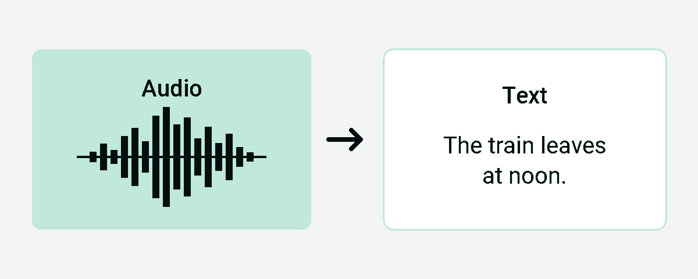

# Whisper Medium

## Overview

Whisper Medium is a multilingual speech recognition model from OpenAI that converts spoken audio into text. It supports voice interfaces, dictation, and transcription of short recordings across many languages. The package runs the audio encoder and text decoder together on SiMa.ai Modalix. Applications provide an audio recording and receive its transcription, with optional language selection or automatic language detection.

## Inputs and outputs

1. Decode the recording to mono audio at 16,000 samples per second, represented as floating-point samples in the range from -1 to 1.
2. Supply the samples as `audio`. Split longer recordings into windows of at most 30 seconds; the bundled processor supplies the padding and audio features needed by the model.
3. Read the generated `text` as the transcription. This package does not provide speaker labels or word timestamps.

## Building applications

Run the package with the [Neat GenAI Model API](https://developer.sima.ai/software/develop-apps/development-workflow/genai-model). For complete applications, start from the [Neat example apps](https://developer.sima.ai/examples).
