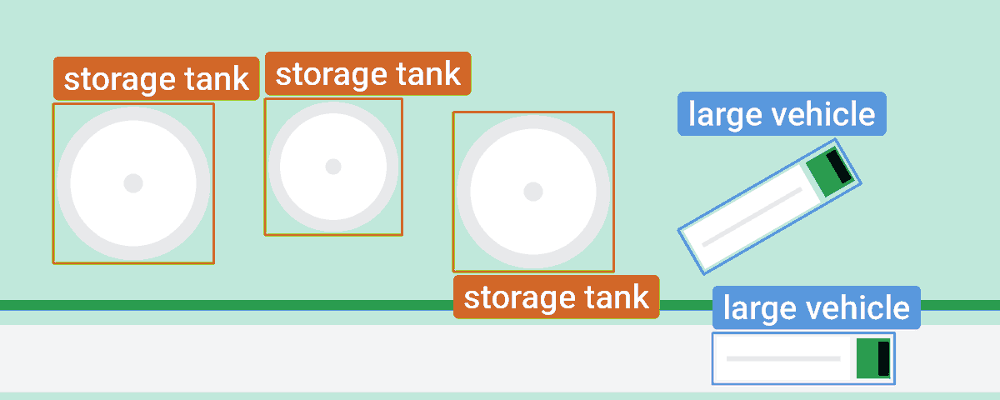

# YOLO11x-obb

## Overview

YOLO11x-obb is the Extra-large size of the Ultralytics YOLO11 oriented-box model,
trained on the 15 DOTA aerial object classes, such as planes and ships. It
finds each object in a 1024×1024 RGB tile of an aerial image and returns a
rotated box around it as raw box, class, and angle outputs at three scales,
which your application decodes with the steps below.

## Inputs and outputs

**Input.** Cut larger images into 1024×1024 windows that overlap by 200 pixels.
Letterbox each window to 1024×1024 with gray (114, 114, 114) padding, scaling it
up with bilinear resampling only when it is smaller, and scale RGB values
to 0–1. Pass a 1024×1024×3 (height, width, channel) float tensor, with Neat's
resize, color conversion, and normalization off.

**Outputs.** Height, width, channel tensors at stride 8, 16, and 32 (grids of
128, 64, and 32 cells; the cell in column c and row r is centered at
(c + 0.5, r + 0.5)):

- `bbox_0` to `bbox_2`: 64 logits, 16 for each of the left, top, right, and bottom sides.
- `class_logit_0` to `class_logit_2`: 15 class logits.
- `angle_0` to `angle_2`: one angle logit.

1. Each side's distance from the cell center, in cells, is the softmax-weighted mean of bin indices 0 to 15.
2. Class scores are sigmoids of their logits; the angle in radians is (sigmoid(logit) − 0.25) × π.
3. The box is left + right wide and top + bottom high, centered half of (right − left, bottom − top) from the cell center, rotated by the angle. Multiply by the stride.
4. Keep scores above your threshold, then apply per-class rotated non-maximum suppression.
5. Undo the letterbox and add the window's offset.
6. Per class, drop boxes overlapping a higher-scoring box from another window by 0.3 or more.

Classes 0 to 14 are plane, ship, storage-tank, baseball-diamond,
tennis-court, basketball-court, ground-track-field, harbor, bridge,
large-vehicle, small-vehicle, helicopter, roundabout, soccer-ball-field, and
swimming-pool. Neat's `YoloV8Obb` box decoder runs steps 1 to 4.

## Building applications

Run the package with the [Neat Model
API](https://developer.sima.ai/software/develop-apps/development-workflow/model).
For complete applications, start from the [Neat example
apps](https://developer.sima.ai/examples).
