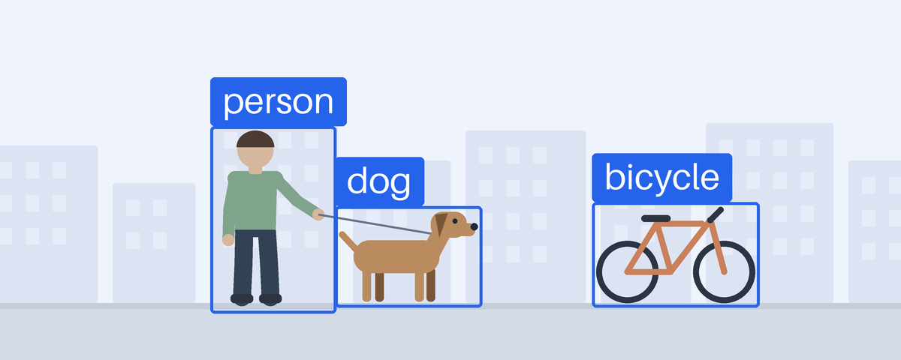

# YOLO26m-det

## Overview

YOLO26m-det finds everyday objects in an image, such as people, vehicles, and
animals, and returns a box, a class, and a score for each one. Use it to count,
track, or monitor objects in live camera streams. It is trained on the 80 object
classes of the COCO dataset. Each object is predicted once, so your application
does not need to remove overlapping boxes.

## Inputs

One 640×640×3 (height, width, channel) RGB image with values from 0 to 1.

Preprocessing:

1. Resize with bilinear resampling so the longer side is 640.
2. Center it on a 640×640 gray (114, 114, 114) frame.
3. Divide by 255.

## Outputs

| Output | Grid | Per cell |
|---|---|---|
| `bbox_0` to `bbox_2` | 80×80, 40×40, 20×20 (stride 8, 16, 32) | distances from the cell center to the left, top, right, and bottom box edges, in cells |
| `class_logit_0` to `class_logit_2` | same | 80 class logits |

Postprocessing:

1. The cell in column c and row r has its center at (c + 0.5, r + 0.5).
2. The box corners are the center minus the left and top distances, and the center plus the right and bottom distances, times the stride.
3. Apply a sigmoid to the class logits to get class scores.
4. Keep the 300 cells with the highest class score, then the 300 best cell-class pairs among them.
5. Remove the padding, divide by the resize scale, and clip to the image.

Class index i is the i-th COCO category ID in ascending order.

## Building applications

Run the package with the [Neat Model API](https://developer.sima.ai/software/develop-apps/development-workflow/model).
For complete applications, start from the [Neat example apps](https://developer.sima.ai/examples).
