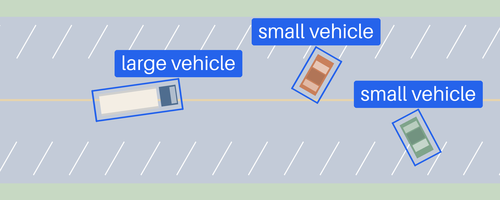

# YOLO26m-obb

## Overview

YOLO26m-obb is the Medium size of the Ultralytics YOLO26 oriented-box model,
trained on the 15 DOTA aerial object classes, such as planes and ships. It
finds each object in a 1024×1024 RGB tile of an aerial image and returns a
rotated box around it. It returns raw box, class, and angle outputs at three
scales, which your application decodes with the steps below.

## Inputs and outputs

**Input.** Cut larger images into 1024×1024 windows that overlap by 200 pixels.
Letterbox each window to 1024×1024 with gray (114, 114, 114) padding, scaling it
up with bilinear resampling only when it is smaller. Scale the RGB values to
0–1. Pass the tile as a 1024×1024×3 (height, width, channel) float tensor, with
Neat's resize, color conversion, and normalization turned off.

**Outputs.** Each tensor is in height, width, channel order, at stride 8, 16, or
32 (grids of 128, 64, and 32 cells):

- `bbox_0` to `bbox_2`: distances from the cell center to the box's left, top, right, and bottom sides, in cells, in the box's rotated frame.
- `class_logit_0` to `class_logit_2`: 15 class logits.
- `angle_0` to `angle_2`: box rotation in radians.

1. The cell in column c and row r has its center at (c + 0.5, r + 0.5).
2. Apply a sigmoid to the logits, then keep the 300 cells with the highest class score and their 300 best cell-class pairs.
3. The box is left plus right wide and top plus bottom high. Its center is the cell center plus half of (right − left, bottom − top), rotated by the angle. Multiply by the stride.
4. Remove the letterbox padding and scale, and add the window's offset.
5. Per class, drop boxes that overlap a higher-scoring box from another window by 0.3 or more.

Class index i is, in order: plane, ship, storage-tank, baseball-diamond,
tennis-court, basketball-court, ground-track-field, harbor, bridge,
large-vehicle, small-vehicle, helicopter, roundabout, soccer-ball-field,
swimming-pool. Neat's `YoloV26Obb` box decoder can also run steps 1 to 3.

## Building applications

Run the package with the [Neat Model
API](https://developer.sima.ai/software/develop-apps/development-workflow/model).
For complete applications, start from the [Neat example
apps](https://developer.sima.ai/examples).
