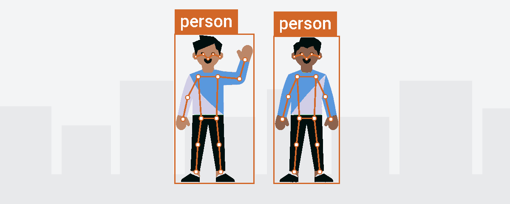

# YOLO26n-pose

## Overview

YOLO26n-pose is the Nano size of the Ultralytics YOLO26 pose model, trained on
COCO people. It finds each person in a 640×640 RGB image and places 17 body
keypoints, such as the eyes, shoulders, and knees. It returns raw box, person
score, and keypoint outputs at three scales, which your application decodes with
the steps below. YOLO26 predicts each person once, so the application does not
need to remove overlapping boxes.

## Inputs and outputs

**Input.** Letterbox the image to 640×640: resize it with bilinear resampling so
its longer side is 640, center it, and fill the rest with gray (114, 114, 114).
Scale the RGB values to 0–1. The reference scripts pass this image as a
640×640×3 (height, width, channel) float tensor, with Neat's resize, color
conversion, and normalization turned off.

**Outputs.** Each tensor is in height, width, channel order, at stride 8, 16, or
32 (grids of 80, 40, and 20 cells):

- `bbox_0` to `bbox_2`: the distances from the cell center to the box's left, top, right, and bottom edges, in cells.
- `class_logit_0` to `class_logit_2`: one person logit.
- `keypoint_0` to `keypoint_2`: 17 keypoints in COCO order, each an x offset, a y offset, and a visibility logit.

1. The cell in column c and row r has its center at (c + 0.5, r + 0.5).
2. The box corners are the center minus the left and top distances, and the center plus the right and bottom distances, times the stride.
3. Apply a sigmoid to the person logits and keep the 300 cells with the highest score.
4. Each keypoint is at the cell center plus its offsets, multiplied by the stride. Apply a sigmoid to its visibility logit.
5. Remove the letterbox padding, divide by the letterbox scale, and clip to the image. Map the keypoints the same way.

Neat's `YoloV26Pose` box decoder can also decode these outputs.

## Building applications

Run the package with the [Neat Model
API](https://developer.sima.ai/software/develop-apps/development-workflow/model).
For complete applications, start from the [Neat example
apps](https://developer.sima.ai/examples).
