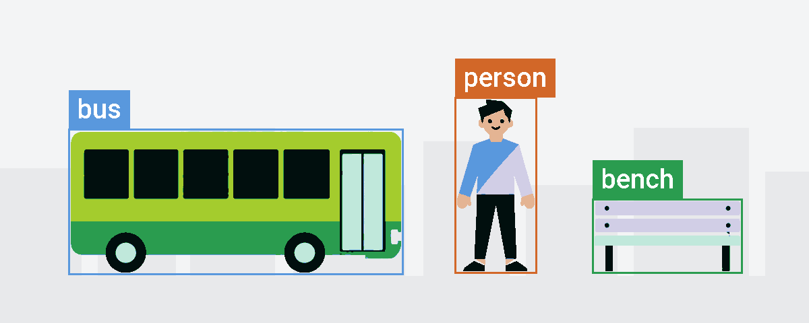

# YOLO26s-det

## Overview

YOLO26s-det finds everyday objects in an image, such as people, vehicles, and
animals, and returns a box, a class, and a score for each one. Use it to count,
track, or monitor objects in live camera streams. It knows only the 80 object
classes of the COCO dataset. It is the second smallest of the five YOLO26
detector sizes from Ultralytics; the larger sizes are more accurate and slower.
Each object is predicted once, so your application does not need to remove
overlapping boxes.

## Inputs and outputs

### Inputs

One 640×640 RGB image with values from 0 to 1.

- With Neat: pass your frame as an image, with letterbox resizing and normalization on.
- Yourself: letterbox the image, that is, resize it with bilinear resampling so its longer side is 640 and center it on a 640×640 gray (114, 114, 114) frame. Divide by 255 and pass a 640×640×3 (height, width, channel) float32 tensor with Neat's preprocessing off.

### Outputs

Detections, each a box, a class index, and a score.

- With Neat: the `YoloV26` box decoder returns the detections. Set `top_k` and `score_threshold` (such as 0.25).
- Yourself: decode these height, width, channel tensors.

| Tensor | Grid | Per cell |
|---|---|---|
| `bbox_0` to `bbox_2` | 80×80, 40×40, 20×20 (stride 8, 16, 32) | distances from the cell center to the left, top, right, and bottom box edges, in cells |
| `class_logit_0` to `class_logit_2` | same | 80 class logits |

1. The cell in column c and row r has its center at (c + 0.5, r + 0.5).
2. The box corners are the center minus the left and top distances, and the center plus the right and bottom distances, times the stride.
3. Apply a sigmoid to the class logits to get class scores.
4. Keep the 300 cells with the highest class score, then the 300 best cell-class pairs among them.
5. Remove the letterbox padding, divide by the letterbox scale, and clip to the image.

Class index i is the i-th COCO category ID in ascending order.

## Building applications

Run the package with the [Neat Model API](https://developer.sima.ai/software/develop-apps/development-workflow/model).
For complete applications, start from the [Neat example apps](https://developer.sima.ai/examples).
