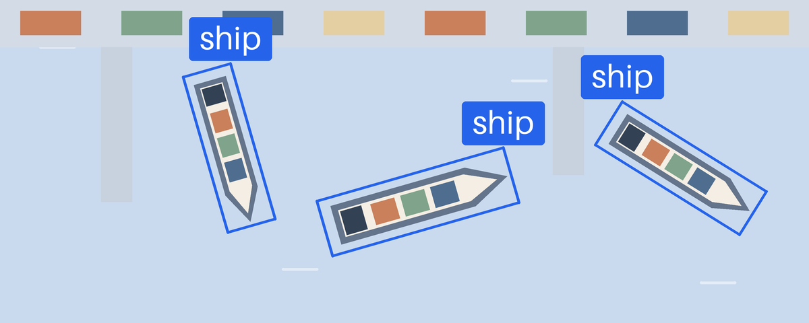

# YOLO26s-obb

## Overview

YOLO26s-obb finds objects in aerial images, such as planes and ships, and
returns a rotated box, a class, and a score for each one. Use it for aerial
surveys or port monitoring. It knows only the 15 DOTA aerial classes. Your
application cuts large images into overlapping windows first. It is the second
smallest of the five YOLO26 oriented-box sizes from Ultralytics; the larger
sizes are more accurate and slower.

## Inputs

One 1024×1024×3 (height, width, channel) RGB window with values from 0 to 1.

Preprocessing:

1. Cut 1024×1024 windows every 824 pixels along each side, so neighbors overlap by 200.
2. Move a side's last window back to end at the image edge.
3. A side up to 1024 gets one window.
4. Resize each window with bilinear resampling so the longer side is 1024.
5. Center it on a 1024×1024 gray (114, 114, 114) frame.
6. Divide by 255.

## Outputs

| Output | Grid | Per cell |
|---|---|---|
| `bbox_0` to `bbox_2` | 128×128, 64×64, 32×32 (stride 8, 16, 32) | distances from the cell center to the left, top, right, and bottom edges of the unrotated box, in cells |
| `class_logit_0` to `class_logit_2` | same | 15 class logits |
| `angle_0` to `angle_2` | same | box angle in radians |

Postprocessing:

1. The cell in column c and row r has its center at (c + 0.5, r + 0.5).
2. The box is left + right wide and top + bottom high.
3. Its center is the cell center plus half of (right − left, bottom − top), rotated by the angle.
4. Multiply center, width, and height by the stride.
5. Apply a sigmoid to the class logits to get class scores.
6. Keep the 300 cells with the highest class score, then the 300 best cell-class pairs among them.
7. Remove the padding, divide by the resize scale, and add the window's offset.
8. Per class, drop every box whose probabilistic IoU with a higher-scoring box from any window is at least 0.3.

Classes 0 to 14: plane, ship, storage-tank, baseball-diamond, tennis-court, basketball-court, ground-track-field, harbor, bridge, large-vehicle, small-vehicle, helicopter, roundabout, soccer-ball-field, swimming-pool.

## Building applications

Run the package with the [Neat Model API](https://developer.sima.ai/software/develop-apps/development-workflow/model).
For complete applications, start from the [Neat example apps](https://developer.sima.ai/examples).
