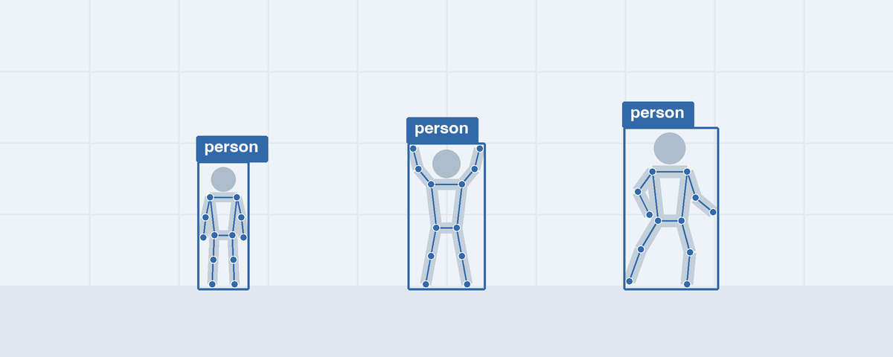

# YOLO26s-pose

## Overview

YOLO26s-pose finds each person in an image and adds 17 body keypoints to the
box, such as the eyes, shoulders, and knees. Use it for activity analysis,
fitness coaching, or fall detection. It returns a box, a score, and the
keypoints for each person, each keypoint with a position and a visibility score.
It detects people only. It is the second smallest of the five YOLO26 pose sizes
from Ultralytics; the larger sizes are more accurate and slower. Each person is
predicted once, so your application does not need to remove overlapping boxes.

## Inputs and outputs

**Input.** One 640×640 RGB image with values from 0 to 1.

- With Neat: pass your frame as an image, with letterbox resizing and normalization on.
- Yourself: letterbox the image, that is, resize it with bilinear resampling so its longer side is 640 and center it on a 640×640 gray (114, 114, 114) frame. Divide by 255 and pass a 640×640×3 (height, width, channel) float32 tensor with Neat's preprocessing off.

**Outputs.** People, each a box, a score, and 17 keypoints.

- With Neat: the `YoloV26Pose` box decoder decodes these outputs. Set `top_k` and `score_threshold` (such as 0.25).
- Yourself: decode these height, width, channel tensors.

| Tensor | Grid | Per cell |
|---|---|---|
| `bbox_0` to `bbox_2` | 80×80, 40×40, 20×20 (stride 8, 16, 32) | distances from the cell center to the left, top, right, and bottom box edges, in cells |
| `class_logit_0` to `class_logit_2` | same | one person logit |
| `keypoint_0` to `keypoint_2` | same | 17 keypoints in COCO order, each an x offset, a y offset, and a visibility logit |

1. The cell in column c and row r has its center at (c + 0.5, r + 0.5).
2. The box corners are the center minus the left and top distances, and the center plus the right and bottom distances, times the stride.
3. Apply a sigmoid to the person logits and keep the 300 cells with the highest score.
4. Each keypoint is at the cell center plus its offsets, multiplied by the stride. Apply a sigmoid to its visibility logit.
5. Remove the letterbox padding, divide by the letterbox scale, and clip to the image. Map the keypoints the same way.

## Building applications

Run the package with the [Neat Model API](https://developer.sima.ai/software/develop-apps/development-workflow/model).
For complete applications, start from the [Neat example apps](https://developer.sima.ai/examples).
