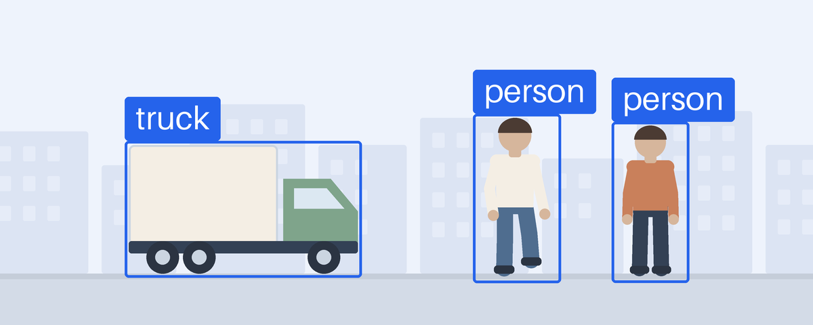

# YOLO26x-det

## Overview

YOLO26x-det is the Extra-Large size of the Ultralytics YOLO26 object detector,
trained on the 80 COCO classes. It takes a 640×640 RGB image and returns raw box
and class outputs at three scales. Your application turns them into detections
with the steps below. YOLO26 predicts each object once, so the application does
not need to remove overlapping boxes.

## Inputs and outputs

**Input.** Letterbox the image to 640×640: resize it with bilinear resampling so
its longer side is 640, center it, and fill the rest with gray (114, 114, 114).
Scale the RGB values to 0–1. The reference scripts pass this image as a
640×640×3 (height, width, channel) float tensor, with Neat's resize, color
conversion, and normalization turned off.

**Outputs.** Each tensor is in height, width, channel order, at stride 8, 16, or
32 (grids of 80, 40, and 20 cells):

- `bbox_0` to `bbox_2`: the distances from the cell center to the box's left, top, right, and bottom edges, in cells.
- `class_logit_0` to `class_logit_2`: 80 class logits.

1. The cell in column c and row r has its center at (c + 0.5, r + 0.5).
2. The box corners are the center minus the left and top distances, and the center plus the right and bottom distances, times the stride.
3. Apply a sigmoid to the logits to get class scores.
4. Keep the 300 cells with the highest class score, then the 300 best cell-class pairs among them.
5. Remove the letterbox padding, divide by the letterbox scale, and clip to the image.

Class index i is the i-th COCO category ID in ascending order. Neat's `YoloV26`
box decoder can also decode these outputs.

## Building applications

Run the package with the [Neat Model
API](https://developer.sima.ai/software/develop-apps/development-workflow/model).
For complete applications, start from the examples in
[sima-neat/apps](https://github.com/sima-neat/apps).
