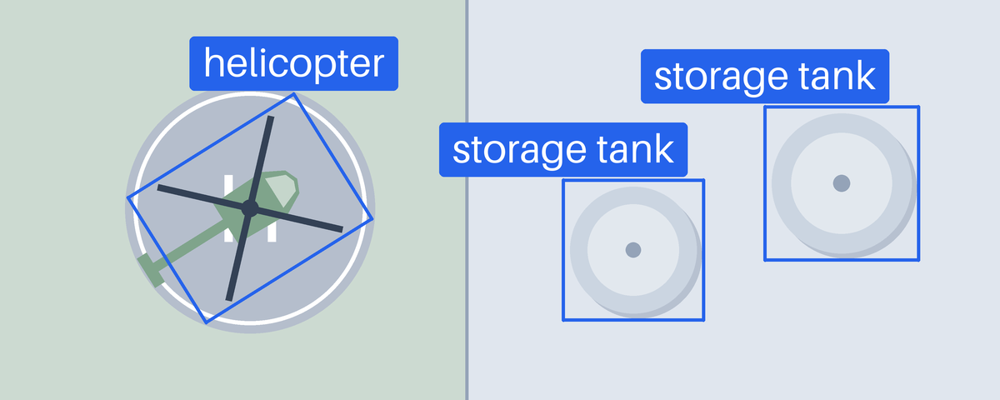

# YOLO26x-obb



## Overview

YOLO26x-obb is the Extra-Large edition of Ultralytics' YOLO26 oriented-box
detector, trained on the 15 object classes of the DOTA-v1.0 aerial image
dataset, such as planes, ships, vehicles, and sports courts. It takes a
letterboxed 1024×1024 RGB tile and returns raw box distances, class logits, and
rotation angles on three feature grids; the application decodes them into
rotated, scored boxes. Larger aerial images must be cut into overlapping tiles
whose detections the application merges. Accuracy is measured as DOTA Task 1 mAP
on a Modalix DevKit over the 458 DOTA-v1.0 validation images. YOLO26 is licensed
under AGPL-3.0, which restricts redistribution of the model and of applications
built on it.

## Usage

Download a published build from the `develop` catalog:

```bash
sima-cli models download \
  --id yolo26x_obb \
  --variant modalix_int8 \
  --branch develop
```

Use `--variant modalix_bf16` for the BF16 build.

The MPK returns raw head tensors for one tile. Tile the image, decode each
tile, and merge the results in the application as described below;
`scripts/accuracy.py` contains a reference implementation.

## Model interface

An aerial image is cut into 1024×1024 windows that overlap by 200 pixels, as
Ultralytics' DOTA split does. A side up to 1024 pixels gets one window, which
ends at the image edge; a longer side gets a window every 824 pixels, the last
moved back to end at the edge. Each tile is letterboxed as in Ultralytics
inference: scaled with bilinear sampling so its longer side is 1024 pixels,
centered, and padded to 1024×1024 with gray value 114. The RGB pixels are then
scaled to `[0, 1]`. The ONNX input `images` is that tile as an NCHW FP32 tensor
with shape `1×3×1024×1024`. With Neat, pass the same tile as an HWC FP32 tensor
with shape `1024×1024×3` and turn off Neat's resize, color conversion, and
normalization.

The model emits nine tensors: a box, a class, and an angle tensor for each of
strides 8, 16, and 32. The MPK returns them in NHWC order:

| Output | MPK shape | Contents |
| --- | --- | --- |
| `bbox_0`, `bbox_1`, `bbox_2` | `1×128×128×4`, `1×64×64×4`, `1×32×32×4` | left, top, right, and bottom side distances in the box's rotated frame, in grid cells |
| `class_logit_0`, `class_logit_1`, `class_logit_2` | `1×128×128×15`, `1×64×64×15`, `1×32×32×15` | logits of the 15 DOTA-v1.0 classes |
| `angle_0`, `angle_1`, `angle_2` | `1×128×128×1`, `1×64×64×1`, `1×32×32×1` | box rotation in radians |

The class order is plane, ship, storage tank, baseball diamond, tennis court,
basketball court, ground track field, harbor, bridge, large vehicle, small
vehicle, helicopter, roundabout, soccer ball field, and swimming pool.

To decode a tile, give the cell in row `r` and column `c` the center
`(c + 0.5, r + 0.5)`. A class score is the sigmoid of its logit. Ultralytics'
end-to-end selection takes the 300 cells with the highest best-class score, then
the 300 highest-scoring cell and class pairs among them. A box's width is the
sum of its left and right distances and its height the sum of its top and
bottom distances. Its center is the cell center plus half the right-minus-left
and bottom-minus-top differences, rotated by the box's angle. Multiply the
center, width, and height by the stride. YOLO26 needs no non-maximum suppression
within a tile.

Map each tile's boxes onto the image by subtracting the letterbox padding,
dividing by the letterbox scale, and adding the window's offset. Then merge the
tiles class by class, as Ultralytics' DOTA merge does: keep a box unless a
higher-scoring box of the same class overlaps it with a probabilistic IoU
(probiou) of 0.3 or more.

## Available builds

The registry declares two build profiles with one `model` component each. Both
compile the whole network into one MLA segment; the compile recipe rejects a
build that places any layer on the A65 or APU.

- `modalix_bf16` runs weights and activations in BF16 and needs no calibration
  data.
- `modalix_int8` quantizes activations per tensor and weights per channel to
  INT8. It calibrates with histogram MSE over 2,048 bins on 50 tiles and applies
  regular bias correction.

## Quality and performance

On a Modalix DevKit, `scripts/accuracy.py` measures DOTA Task 1 oriented-box
mAP on the 458 DOTA-v1.0 validation images. The `dota_obb_accuracy` result is
published as an accuracy run for each build: `dota_obb_map50` at IoU 0.5 and
`dota_obb_map` averaged over IoU 0.50 to 0.95. The package declares no reference
score: Ultralytics'
[published scores](https://github.com/ultralytics/ultralytics/blob/f2d3aed634a5b0e4828024718d4a61ab2f83fb19/docs/en/tasks/obb.md)
come from multi-scale inference on the DOTA-v1.0 test split, scored by the DOTA
evaluation server, which this single-scale validation measurement does not
reproduce.

The script tiles each image as described above, letterboxes each tile on the
CPU, runs the MPK, and decodes it with Ultralytics' end-to-end selection,
keeping up to 300 boxes per tile with a score above 0.001. It merges the tiles
of each image with the probiou merge and scores the full-image boxes with the
DOTA development kit's Task 1 rules: polygon IoU, VOC 2007 11-point AP, and
objects marked difficult neither counted nor penalized. Both metrics average the
classes that have labelled objects. Ultralytics' DOTA split saves tiles as JPEG
files, and its validator batches them as padded rectangles and scores each tile
on its own; this script crops tiles in memory, always uses a 1024×1024 square,
and scores whole images.

The benchmark script runs Neat Core's default synthetic benchmark on the MPK,
and CI publishes one result for each build.

## Source and license

The source is the `yolo26x-obb.pt` checkpoint from Ultralytics' YOLO26
repository on Hugging Face, exported to ONNX with Ultralytics 8.4.0. Normal
compilation consumes the pinned ONNX and does not install the exporter
dependencies.

- [YOLO26 model card](https://huggingface.co/Ultralytics/YOLO26)
- [Pinned checkpoint revision](https://huggingface.co/Ultralytics/YOLO26/tree/070ac3c51435984d992ba92eb3f234daf4e4500d)
- [Ultralytics 8.4.0 source](https://github.com/ultralytics/ultralytics/tree/f2d3aed634a5b0e4828024718d4a61ab2f83fb19)

YOLO26 is distributed under AGPL-3.0. Its redistribution terms apply to the
compiled MPKs and to applications that include them.

## Reproducing the artifact

### Conversion

The `conversion.default` entry in `model.yaml` pins the checkpoint, and
`scripts/requirements-convert.txt` pins the export dependencies. They install
Ultralytics as `ultralytics-opencv-headless`, which ships the same code as
`ultralytics` with headless OpenCV, so conversion needs no system graphics
libraries. `convert.py` exports with Ultralytics at 1024×1024 and opset 12 and
folds constants with onnxsim, so surgery starts from a static graph. On Linux
ARM64, the shared runner script converts in a fresh Python 3.12 environment
built from those requirements:

```bash
scripts/run_model_conversion.sh models/yolo26x_obb default /tmp/yolo26x_obb-export
```

To publish a conversion, manually run **Vulcan Model Convert** with model
`yolo26x_obb`. The workflow validates the ONNX, compares the raw box, class, and
angle head tensors with PyTorch on ten synthetic inputs, and uploads
`model.onnx`. Copy the printed source pin into `model.yaml` only after surgery
and compiler validation. The smoke comparison does not measure model accuracy.

### Calibration and compilation

`surgery.py` cuts the graph at the last convolution of each one-to-one OBB
branch and names the nine outputs. Removing the in-graph rotated-box decode and
top-300 selection lets the whole network run on the MLA. The cut changes no
values: the head tensors match the full graph exactly.

The INT8 build calibrates on one tile from each of the first 50 images listed
in the `cal` variant of the DOTA-v1.0 dataset, which draws from the training
split, so no scored validation image calibrates the model. Each tile is the
image's window with the most labelled object centers, so calibration sees
objects rather than empty ground or water. In the pinned Model Compiler
environment, compile one build with the shared runner script. It resolves the
source and the calibration archive, runs `scripts/compile.py`, and validates the
MPK:

```bash
scripts/run_model_compilation.sh models/yolo26x_obb modalix_int8 model /tmp/yolo26x_obb
```

The MPK lands in `/tmp/yolo26x_obb/yolo26x_obb/modalix_int8/model/`. Use
`modalix_bf16` for the BF16 build, which needs no calibration archive. Cut
graphs and generated models stay in a temporary directory outside Git.

### DevKit accuracy

The `dota_obb_accuracy` accuracy entry declares the DOTA-v1.0 `val` dataset
archive, which holds the 458 validation images and their DOTA label files, and
the published metrics. On a Modalix DevKit, run the accuracy stage on the output
of `scripts/run_model_compilation.sh`, setting `REGISTRY_PYTHON` to a Python
that has the full Model Registry tooling and Dataset Registry:

```bash
scripts/run_model_accuracy.sh models/yolo26x_obb modalix_int8 \
  /tmp/yolo26x_obb /media/nvme/neat-tests/yolo26x_obb-accuracy
```

The script installs `scripts/requirements-accuracy.txt` beside PyNeat's
environment, extracts the archive under `/media/nvme/neat-tests/`, and removes
both when it exits. See
[Accuracy on the DevKit](../../docs/local-accuracy-development.md#accuracy-on-the-devkit)
for the result format and publication.
