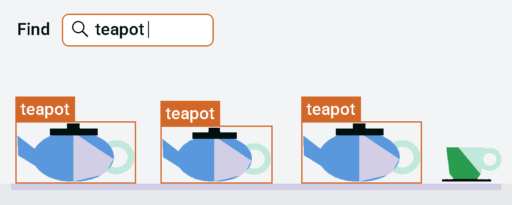

# YOLO-World v2 L

## Overview

YOLO-World v2 L detects objects described by text, including categories outside a fixed training label list. The package contains a CLIP text encoder and an image detector. Encode class names when they change, then reuse their vectors for every image. The detector supports up to 80 active prompts through fixed input slots and a binary mask. Prompt selection also conditions image features, so changing the class list can change existing detections. With no classes selected, the application should skip detection.

## Inputs and outputs

Letterbox RGB images to 640×640 with centered padding of 114 and divide pixels by 255. Pass `images` in height, width, channel order.

The package ships `prompt_assets/tokenizer.json` and `prompt_assets/token_embedding_table.npy` beside the compiled components. Tokenize each class, right-pad to 77 tokens with end-of-text ID 49407, and look up its token vectors on the CPU. The text encoder takes `token_embeddings` [1,1,77,512] and `eos_selector` [1,1,96,1], with one at the first end-of-text position. Only the first 77 selector entries are used. It returns `text_embeddings` [1,1,1,512].

1. Normalize each returned 512-value vector and cache it. Fill detector `text_embeddings` [1,80,512] and `prompt_mask` [1,80]; use one for active slots and zero for inactive slots, with at least one active slot.
2. Decode `bbox_dfl_s8`, `bbox_dfl_s16`, `bbox_dfl_s32`: softmax each edge's 16 bins, project onto 0–15, and apply stride 8, 16 or 32 around grid-cell centers.
3. Read `class_prob_s8`, `class_prob_s16`, `class_prob_s32` directly as probabilities. A class index identifies the corresponding prompt slot. Apply class-aware suppression and map coordinates back through the letterbox transform. Neat's `YoloV8` decoder with `GroupedByRoleProbability` handles these six outputs.

## Building applications

Run the package with the [Neat Model API](https://developer.sima.ai/software/develop-apps/development-workflow/model). For complete applications, start from the [Neat example apps](https://developer.sima.ai/examples).
