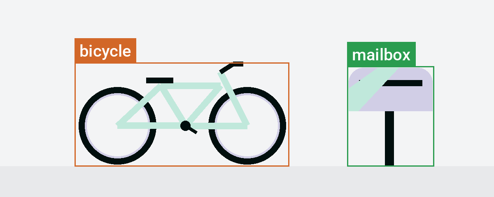

# YOLO-Worldv2-M

## Overview

YOLO-Worldv2-M finds the objects you name in text and returns a box, a class,
and a score for each. Use it to detect objects outside any fixed class list,
without training. Encode each of up to 80 names once and reuse its vector for
every image. Changing the list can change the other names' detections. It is the M size of Tencent AI
Lab's YOLO-Worldv2. The larger sizes are more accurate and slower.

## Inputs and outputs

**Text input.** Up to 80 names, each encoded once with the package's `prompt_assets` files.

1. Tokenize with `tokenizer.json`, right-pad to 77 tokens with end-of-text ID 49407, and look each token up in `token_embedding_table.npy` to fill `token_embeddings`, 1×1×77×512.
2. Set `eos_selector`, 1×1×96×1, to one at the first end-of-text position. Only its first 77 entries are used.
3. Run the text encoder, divide the 512-value `text_embeddings` by its length, and cache it.

**Image input.** `images`, one 640×640×3 (height, width, channel) RGB image with values from 0 to 1. Letterbox with bilinear resampling and centered (114, 114, 114) padding, and divide by 255.

**Between the components.** Fill the detector's `text_embeddings`, 1×80×512, with the cached vectors, and set `prompt_mask`, 1×80, to one for used slots, else zero. At least one slot must be used: with no names, skip the detector.

**Outputs.** Detections, each a box, a score, and the slot index of its name.

- With Neat: the `YoloV8` box decoder with the `GroupedByRoleProbability` option returns the detections. Set 80 classes, an overlap threshold of 0.7, `top_k`, `score_threshold`, the original image size, and letterbox resize mode.
- Yourself: decode these height, width, channel tensors.

| Tensor | Grid | Per cell |
|---|---|---|
| `bbox_dfl_s8`, `bbox_dfl_s16`, `bbox_dfl_s32` | 80×80, 40×40, 20×20 (stride 8, 16, 32) | 16 bin logits per box edge: left, top, right, bottom |
| `class_prob_s8`, `class_prob_s16`, `class_prob_s32` | same | 80 class probabilities |

1. Softmax each edge's 16 bins and sum bin index (0 to 15) times probability. This is the edge's distance in cells from the cell center (c + 0.5, r + 0.5).
2. The corners are the center minus (left, top) and the center plus (right, bottom), times the stride.
3. Keep the cell and class pairs that score above your threshold.
4. Within each class, remove boxes that overlap above 0.7.
5. Undo the letterbox and clip to the image.

## Building applications

Run the package with the [Neat Model API](https://developer.sima.ai/software/develop-apps/development-workflow/model). For complete applications, start from the [Neat example apps](https://developer.sima.ai/examples).
