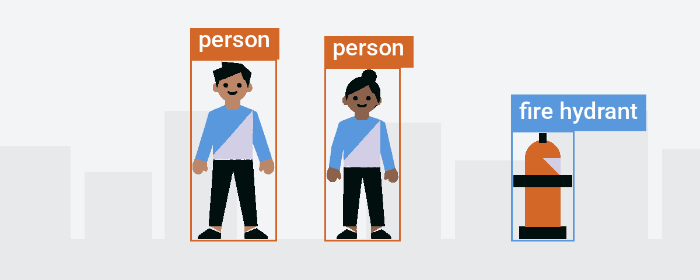

# YOLOv8m-det

## Overview

YOLOv8m-det is the Medium size of the Ultralytics YOLOv8 object detector,
trained on the 80 COCO classes. It finds obstacles such as people, vehicles, and
animals for drones and robots. It takes a 640×640 RGB image and returns raw box
and class outputs at three scales. Your application turns them into detections
with the steps below. YOLOv8 predicts overlapping boxes for one object, so the
application filters them by score and removes duplicates with non-maximum
suppression.

## Inputs and outputs

**Input.** Letterbox the image to 640×640: resize it with bilinear resampling so
its longer side is 640, center it, and fill the rest with gray (114, 114, 114).
Scale the RGB values to 0–1. The reference scripts pass this image as a
640×640×3 (height, width, channel) float tensor, with Neat's resize, color
conversion, and normalization turned off.

**Outputs.** Each tensor is in height, width, channel order, at stride 8, 16, or
32 (grids of 80, 40, and 20 cells):

- `bbox_0` to `bbox_2`: 64 values per cell, 16 bins for each of the left, top, right, and bottom edge distances.
- `class_logit_0` to `class_logit_2`: 80 class logits.

1. The cell in column c and row r has its center at (c + 0.5, r + 0.5).
2. Apply a softmax over each edge's 16 bins; the edge distance in cells is the probability-weighted mean bin index.
3. The box corners are the center minus the left and top distances, and the center plus the right and bottom distances, times the stride.
4. Apply a sigmoid to the logits and keep the cell-class pairs above your score threshold.
5. Remove overlapping boxes of the same class with non-maximum suppression at an overlap threshold of 0.7.
6. Remove the letterbox padding, divide by the letterbox scale, and clip to the image.

Class index i is the i-th COCO category ID in ascending order. Neat's `YoloV8`
box decoder decodes these outputs; give its score threshold as a probability,
such as 0.25.

## Building applications

Run the package with the [Neat Model API](https://developer.sima.ai/software/develop-apps/development-workflow/model). For complete applications, start from the [Neat example apps](https://developer.sima.ai/examples).
