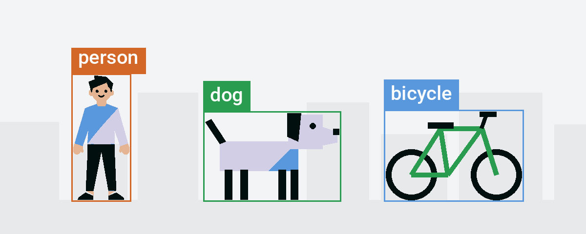

# YOLOv8n-det

## Overview

YOLOv8n-det finds everyday objects in an image, such as people, vehicles, and
animals, and returns a box, a class, and a score for each one. Use it to count,
track, or monitor objects in live camera streams. It knows only the 80 object
classes of the COCO dataset. It is the smallest of the five YOLOv8 detector
sizes from Ultralytics; the larger sizes are more accurate and slower. It
predicts several overlapping boxes for one object, and decoding removes the
duplicates.

## Inputs

One 640×640×3 (height, width, channel) RGB image with values from 0 to 1.

Preprocessing:

1. Resize with bilinear resampling so the longer side is 640.
2. Center it on a 640×640 gray (114, 114, 114) frame.
3. Divide by 255.

## Outputs

| Output | Grid | Per cell |
|---|---|---|
| `bbox_0` to `bbox_2` | 80×80, 40×40, 20×20 (stride 8, 16, 32) | 64 logits: 16 bins for each of the left, top, right, and bottom edge distances |
| `class_logit_0` to `class_logit_2` | same | 80 class logits |

Postprocessing:

1. The cell in column c and row r has its center at (c + 0.5, r + 0.5).
2. Apply a softmax over each edge's 16 bins. The edge distance in cells is the probability-weighted mean bin index, from 0 to 15.
3. The box corners are the center minus the left and top distances, and the center plus the right and bottom distances, times the stride.
4. Apply a sigmoid to the class logits to get class scores.
5. Keep the cell-class pairs with a score above your score threshold.
6. Among boxes of the same class, from the highest score down, drop every box whose intersection over union with a kept box is more than 0.7. Keep at most 300 boxes.
7. Remove the padding, divide by the resize scale, and clip to the image.

Class index i is the i-th COCO category ID in ascending order.

## Building applications

Run the package with the [Neat Model API](https://developer.sima.ai/software/develop-apps/development-workflow/model).
For complete applications, start from the [Neat example apps](https://developer.sima.ai/examples).
