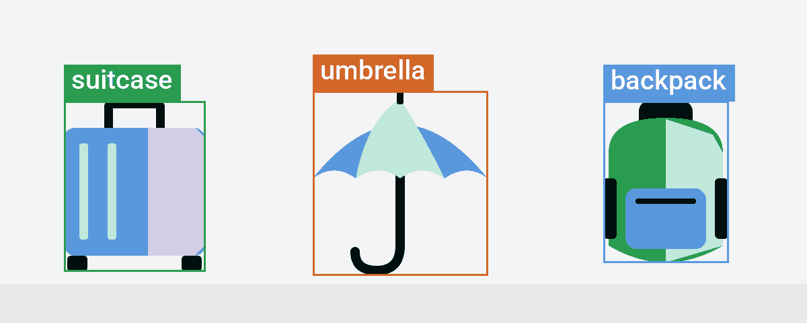

# YOLOX-m

## Overview

YOLOX-m finds everyday objects in an image, such as people, vehicles, and
animals, and returns a box, a class, and a score for each one. Use it to count,
track, or monitor objects in live camera streams. It knows the 80 COCO classes.
It is the M size of the YOLOX detector from Megvii. The larger sizes are more
accurate and slower. It expects blue, green, red color order and unscaled pixel
values.

## Inputs

One 640×640 BGR image with values from 0 to 255.

- With Neat: pass your frame as an image, with letterbox resizing, a pad value of 114, color conversion to BGR, and normalization with mean 0 and standard deviation 1/255.
- Yourself: letterbox to 640×640 with bilinear resampling and centered (114, 114, 114) padding, and pass a 640×640×3 (height, width, channel) float tensor with Neat's preprocessing off.

## Outputs

Detections, each a box, a class index, and a score.

- With Neat: the `YoloX` box decoder returns the detections. Set 80 classes, the `Split3Interleaved` output layout, an overlap threshold of 0.65, `top_k`, and `score_threshold`, such as 0.25.
- Yourself: decode these height, width, channel tensors.

| Tensor | Grid | Per cell |
|---|---|---|
| `bbox_0` to `bbox_2` | 80×80, 40×40, 20×20 (stride 8, 16, 32) | dx, dy, log width, and log height |
| `objectness_logit_0` to `objectness_logit_2` | same | one objectness logit |
| `class_logit_0` to `class_logit_2` | same | 80 class logits |

1. For column c, row r, and stride s, the box center is ((dx + c) × s, (dy + r) × s).
2. The width and height are exp(log width) × s and exp(log height) × s. Subtract or add half of each to get the corners.
3. Apply a sigmoid to all logits. The score is the objectness times the highest class probability.
4. Filter by score and apply non-maximum suppression within each class at an overlap threshold of 0.65.
5. Remove the centered padding, divide by the letterbox scale, and clip to the image.

Class index i is the i-th COCO category ID in ascending order.

## Building applications

Run the package with the [Neat Model API](https://developer.sima.ai/software/develop-apps/development-workflow/model). For complete applications, start from the [Neat example apps](https://developer.sima.ai/examples).
