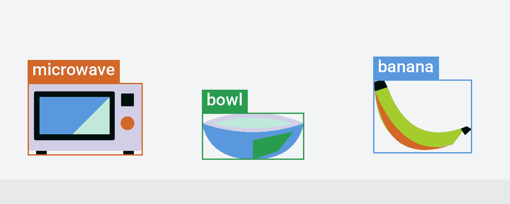

# YOLOX-Nano-det

## Overview

YOLOX-Nano-det is the Nano size of the Megvii YOLOX object detector, trained on the
80 COCO classes. It takes a 416×416 BGR image and returns raw box, objectness,
and class outputs at three scales. The package runs as one component. Your
application combines objectness with the most likely class at each grid cell,
filters weak predictions, and removes duplicate boxes. Use the decoder below to map the outputs to the original image.

## Inputs and outputs

**Input.** Letterbox to 416×416: resize with bilinear resampling so the longer
side is 416, center the image, and fill the remaining area with (114, 114, 114).
Keep BGR values in 0–255. For tensor input, provide a 416×416×3 float32 tensor
and disable Neat's resize, color conversion, and normalization. For image
input, declare the source color order and let Neat produce the same BGR values.

**Outputs.** The three levels use strides 8, 16, and 32, with grids of 52, 26, 13
cells. Each output is in height, width, channel order:

- `bbox_0` to `bbox_2`: four values per cell, dx, dy, log width, and log height.
- `objectness_logit_0` to `objectness_logit_2`: one objectness logit per cell.
- `class_logit_0` to `class_logit_2`: 80 class logits per cell.

1. For column c, row r, and stride s, the box center is ((dx + c) × s, (dy + r) × s).
2. The width and height are exp(log width) × s and exp(log height) × s; subtract or add half of each size to get the corners.
3. Apply sigmoid to objectness and class logits; the score is objectness probability times the highest class probability.
4. Filter by score and apply non-maximum suppression within each class at an overlap threshold of 0.65.
5. Remove the centered padding, divide by the letterbox scale, and clip to the original image.

Class index i is the i-th COCO category ID in ascending order. Neat's `YoloX`
box decoder handles these outputs. For example, use a score threshold of 0.25.

## Building applications

Run the package with the [Neat Model API](https://developer.sima.ai/software/develop-apps/development-workflow/model). For complete applications, start from the [Neat example apps](https://developer.sima.ai/examples).
