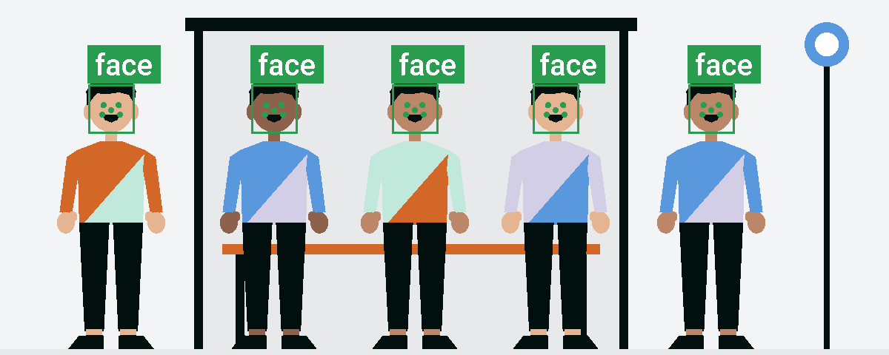

# YuNet-n

## Overview

YuNet-n finds faces in an image and returns a box, a score, and five landmarks for
each face: the two eyes, the nose tip, and the two mouth corners. Use it to count
people, blur faces for privacy, or crop and align faces before face recognition. It
is trained on WIDER FACE. It expects blue, green, red color order and unscaled pixel
values.

## Inputs

One 640×640×3 (height, width, channel) BGR image with values from 0 to 255.

Preprocessing:

1. Resize with bilinear resampling so the longer side is 640.
2. Center it on a 640×640 black (0, 0, 0) frame.
3. Keep the blue, green, red channel order and the 0 to 255 values.

## Outputs

| Output | Grid | Per cell |
|---|---|---|
| `cls_8`, `cls_16`, `cls_32` | 80×80, 40×40, 20×20 (stride 8, 16, 32) | one face probability |
| `obj_8`, `obj_16`, `obj_32` | same | one objectness probability |
| `bbox_8`, `bbox_16`, `bbox_32` | same | dx, dy, log width, and log height |
| `kps_8`, `kps_16`, `kps_32` | same | dx and dy for each of the five landmarks |

Postprocessing:

1. For column c, row r, and stride s, the score is the square root of the face probability times the objectness probability, each clipped to 0 to 1.
2. The box center is ((dx + c) × s, (dy + r) × s), and its width and height are exp(log width) × s and exp(log height) × s.
3. The box corners are the center minus and plus half the width and height.
4. Landmark k is at ((dx_k + c) × s, (dy_k + r) × s).
5. Keep the faces whose score passes your threshold.
6. Remove each box that overlaps a higher-scoring box by more than 0.45.
7. Subtract the padding from every x and y, then divide all coordinates and sizes by the resize scale.

The landmarks come in this order: the person's right eye, left eye, nose tip, right mouth corner, and left mouth corner.

## Building applications

Run the package with the [Neat Model API](https://developer.sima.ai/software/develop-apps/development-workflow/model).
For complete applications, start from the [Neat example apps](https://developer.sima.ai/examples).
